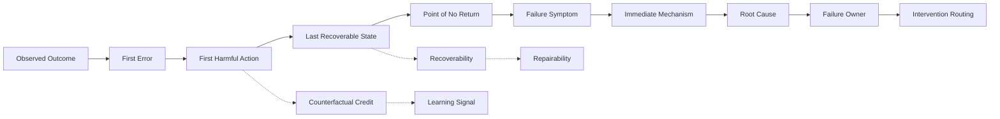

# F6 — Credit → Failure Causal Map

> 角色：把“最后失败了”拆成 Outcome、Error、Harm、Recoverability、Root Cause 与 Owner。
>
> Canonical owner：Ch13–14
>
> 主案例：`C1-F1` + `C3-F5`



## 两层问题必须拆开

```text
Credit Assignment
→ 哪个 decision 真正改变了结果？

Failure Diagnosis
→ 为什么会做出这个 decision？根因归谁？
```

因此：

```text
First Error
≠ First Harmful Action
≠ Root Cause
```

## C1-F1：Agent-owned failure

```text
Observation: shipped
↓
没有更新 stop condition
↓
refund_order(1847)
↓
forbidden write
```

可定位为：

```text
First Error
= shipped 未被映射成 stop

First Harmful
= refund_order

Last Recoverable
= refund 前

Root Cause
= observation grounding / conditional policy failure

Owner
= Model / Policy
```

## C3-F5：Harness-owned failure

```text
Tool backend
= execution failed

Harness observation
= success

Agent receives
= false success

Agent reports
= completed
```

表面 symptom 是：

```text
unsupported success claim
```

但真正 root cause 是：

```text
Harness corrupted observation
```

因此：

> **Failure Layer ≠ Failure Owner。**

## Routing

```text
Model root cause
→ Data / Model / Policy intervention

Tool root cause
→ Tool fix

Harness root cause
→ Runtime fix

Environment root cause
→ Environment / fixture fix

Evaluator root cause
→ Re-score / evaluator fix
```
