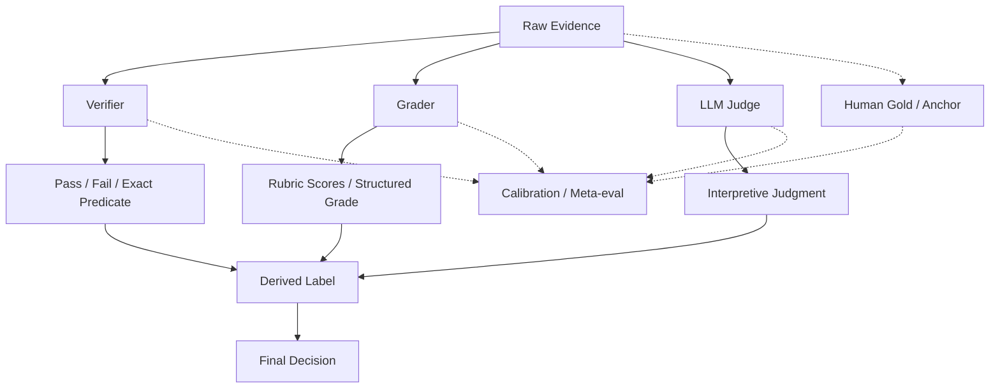

# F7 — Evidence → Verifier → Grader → Judge

> **Figure Question：** 一条 Label 到底建立在什么 Evidence 和 Evaluator 上，什么时候应该 abstain？
>
> **Level：** Part-level
>
> **Canonical Owner：** Ch15
>
> **Primary Case：** `C1-VB` + `C5-F3`
>
> **Scope：** 固定 Evidence、Verifier、Grader、Judge、Derived Label 与 Meta-evaluation 的关系；统计比较与 benchmark protocol 交给 F8 / Ch16。



## Read the Spine

先从 Claim 所需要的 Evidence 出发：

```text
Raw Evidence
→ Verifier / Grader / Judge
→ Raw Judgment
→ Derived Label
→ Final Decision
```

旁边的 Gold / Anchor 不替代真实 Evidence，而是：

```text
校准 evaluator
审计 bias
决定 route / replace / abstain
```

因此 Evaluation System 的起点应该是：

> **Evidence First, Judge Second。**

## Critical Boundaries

```text
Evidence
≠ Judgment
≠ Label
≠ Final Decision

Verifier
⊂ Grader / Evaluator family

Judge
≠ Ground Truth

Agreement
≠ Validity
```

证据不足时应该允许：

```text
UNRESOLVED
ABSTAIN
HUMAN ESCALATION
```

而不是为了覆盖率强行给 PASS / FAIL。

## Case Lens

### C1-VB — Environment truth first

```text
World State:
refund.created = false
```

对于“是否真的退款”这个 Claim，它比：

```text
Agent final response:
“没有退款”
```

更强。

### C5-F3 — Executable truth over style preference

```text
Candidate A
LLM Judge: looks excellent
Executable Tests: fail

Candidate B
LLM Judge: less polished
Executable Tests: pass
```

对于“代码是否正确”这一维度：

```text
Executable Verifier
>
LLM preference on style
```

这里的 `>` 不是普遍 evaluator 排名，而是：

> **在该 Claim 上，哪个 Evidence 更直接。**

## Cross-links

- [`Ch15 — Grader / Verifier / LLM-as-a-Judge`](../15_Grader_Verifier_and_LLM_as_a_Judge.md)
- [`F6 — Credit → Failure Causal Map`](./F6_Credit_to_Failure_Causal_Map.md)
- [`F8 — Benchmark / Evaluation Protocol`](./F8_Benchmark_Evaluation_Protocol.md)
- [`C1 — Order / Refund Agent`](../cases/C1_Order_Refund_Agent.md)
- [`C5 — Code / Execution Agent`](../cases/C5_Code_Execution_Agent.md)

## Caption

**F7 — Evidence → Verifier → Grader → Judge.** 可信 Label 必须从足够的 Evidence 出发，再选择适合该 Claim 的 evaluator；Judge 不能替代环境或执行真值，证据不足时 `UNRESOLVED / ABSTAIN` 往往比强行判定更专业。
