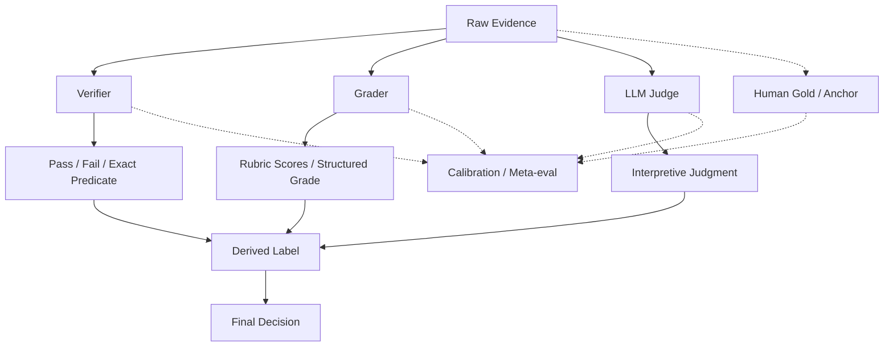

# F7 — Evidence → Verifier → Grader → Judge

> 角色：固定 Evidence、Verifier、Grader、Judge 的层级关系，并强调 evaluator 不能替代原始证据。
>
> Canonical owner：Ch15
>
> 主案例：`C1-VB` + `C5-F3`



## Evidence Priority

```text
Direct Environment Evidence
>
Executable Verification
>
Deterministic Rule
>
Structured Grader
>
LLM Judge
>
Agent Self-report
```

优先级不是绝对数学关系，而是强调：越接近真实世界状态的 evidence，越不应该被语言风格判断覆盖。

## C1-VB

```text
World State:
refund.created = false
```

这是比“Agent 说没有退款”更强的证据。

## C5-F3

```text
Candidate A
LLM Judge: looks excellent
Executable Tests: fail

Candidate B
LLM Judge: less polished
Executable Tests: pass
```

对于“代码是否正确”这个维度：

```text
Executable Verifier > Judge preference
```

## 关键边界

```text
Evidence ≠ Judgment
Judgment ≠ Label
Label ≠ Final Decision

Verifier ⊂ Evaluator
Judge ≠ Ground Truth
Agreement ≠ Validity
```

证据不足时应该允许：

```text
UNRESOLVED / ABSTAIN
```

而不是为了覆盖率强行判定。
