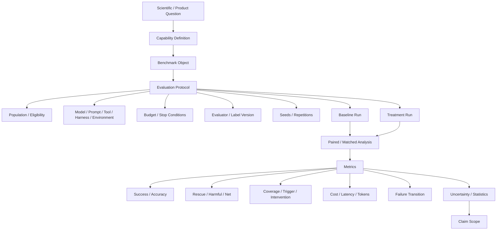

# F8 — Benchmark / Evaluation Protocol

> 角色：固定“一个模型 / 方法提升结论到底怎样成立”。
>
> Canonical owner：Ch16
>
> 主案例：C1 family / paired model comparison



## 四个不同对象

```text
Benchmark Object
= 测什么 case

Evaluation Protocol
= 怎么运行和怎么判

Evaluation Run
= 某一次具体执行

Evaluation Report
= 对 runs 的统计与结论
```

## Population Accounting

Selective / triggered system 必须保留：

```text
Full Population
↓
Eligible
↓
Triggered
↓
Intervened
↓
Resolved / Observed Outcome
```

任何分数必须说明 denominator。

## Paired Comparison

同一 Case 上比较 Baseline 与 Treatment：

```text
Baseline wrong → Treatment right
= Rescue / Repair

Baseline right → Treatment wrong
= Harmful / Degradation
```

仅比较两个总体平均分，会隐藏 intervention 到底修了什么、伤了什么。

## Budget Discipline

```text
Better Score
```

必须同时问：

```text
Same token budget?
Same tool budget?
Same number of candidates?
Same latency class?
```

否则结论可能只是：

> 花了更多计算，所以更高。

## Claim Scope

最后的结论应与证据匹配：

```text
Observed on this benchmark / protocol
≠
Universal capability improvement
```

尤其小样本、many-config exploration、single-seed 结果需要限制表述范围。
