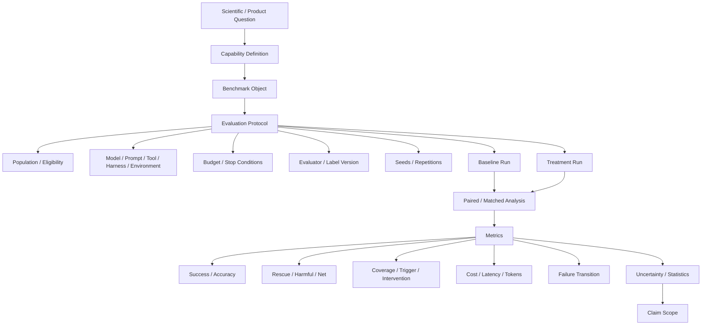

# F8 — Benchmark / Evaluation Protocol

> **Figure Question：** “这个模型 / 方法更好”这一结论到底怎样才成立？
>
> **Level：** Book-level
>
> **Canonical Owner：** Ch16
>
> **Primary Case：** `C1` family / paired Baseline–Treatment comparison
>
> **Scope：** 固定从 Scientific Question 到 Claim Scope 的完整比较协议；不负责单样本 evaluator semantics，那部分由 F7 / Ch15 定义。



## Read the Spine

真正的主链不是：

```text
Run Model A
→ Run Model B
→ compare accuracy
```

而是：

```text
Question
→ Capability
→ Benchmark Object
→ Frozen Protocol
→ Baseline / Treatment Runs
→ Paired / Matched Analysis
→ Metrics
→ Uncertainty
→ Claim Scope
```

其中 Protocol 必须冻结至少：

```text
Population
Runtime
Budget
Evaluator
Seeds / Repetitions
```

否则“方法差异”和“实验条件差异”会混在一起。

## Critical Boundaries

```text
Benchmark Object
≠ Evaluation Protocol
≠ Evaluation Run
≠ Evaluation Report

Full Population
≠ Triggered Population

Better Score
≠ Better Score at Matched Budget

Observed Improvement
≠ Universal Capability Improvement
```

尤其 selective / triggered system：

```text
Full Population
↓
Eligible
↓
Triggered
↓
Intervened
↓
Observed Outcome
```

每一个分数都必须说明 denominator。

## Case Lens — C1 Family

同一 Case 比较 Baseline 和 Treatment：

```text
Baseline wrong
→ Treatment right
= Rescue / Repair

Baseline right
→ Treatment wrong
= Harmful / Degradation

Both same
= Neutral transition
```

只看两个总体均值，会把：

```text
修了多少
伤了多少
在哪些 slice 上变化
```

全部压掉。

同时还要比较：

```text
Tokens
Tool Calls
Candidates
Latency
Coverage
```

否则“更好”可能只是“花得更多”。

## Cross-links

- [`Ch15 — Grader / Verifier / Judge`](../15_Grader_Verifier_and_LLM_as_a_Judge.md)
- [`Ch16 — Benchmark Design & Evaluation Protocol`](../16_Benchmark_Design_and_Evaluation_Protocol.md)
- [`F7 — Evidence → Evaluator Stack`](./F7_Evidence_Verifier_Grader_Judge.md)
- [`F9 — Data Flywheel`](./F9_Data_Flywheel.md)
- [`C1 — Order / Refund Agent`](../cases/C1_Order_Refund_Agent.md)

## Caption

**F8 — Benchmark / Evaluation Protocol.** 一个“方法更好”的结论需要从问题、能力、benchmark、冻结协议、matched run、metrics、uncertainty 一直走到 claim scope；尤其 selective system 必须保持 population accounting，且任何收益都应同时报告预算和代价。
