# F9 — Data Flywheel

> **Figure Question：** 一个真实 Failure / Opportunity 怎样重新进入下一轮 Learning Loop？
>
> **Level：** Book-level
>
> **Canonical Owner：** Ch17
>
> **Primary Case：** `C1` Order / Refund family
>
> **Scope：** 固定从现实 signal 到正确 intervention、controlled validation、deploy 与 refresh 的闭环；不把 Flywheel 简化成“收 bad case → 加训练”。

```mermaid
flowchart LR
    P[Production / Real Use] --> S[Signals<br/>Failure / Feedback / Drift]
    S --> T[Triage]
    T --> A[Attribution / Root Cause]
    A --> G[Capability Gap]
    G --> Q[Prioritize / Data Strategy]
    Q --> ACQ[Acquire Experience]
    ACQ --> SUP[Construct Supervision]
    SUP --> CUR[Curate / Filter / Mixture]
    CUR --> EXP[Controlled Data Experiment]
    EXP --> TR[Train / Optimize]
    TR --> EV[Evaluate / Regression]
    EV --> D{Deploy?}
    D -- Yes --> P
    D -- No --> G

    P -.-> MON[Monitoring / Drift]
    MON -.-> S
```



## Read the Spine

主链是：

```text
Real Use
→ Signal
→ Triage
→ Root Cause
→ Capability Gap
→ Prioritize
→ Acquire Experience
→ Construct Supervision
→ Curate
→ Controlled Experiment
→ Train
→ Evaluate
→ Deploy / Revise
↺
```

所以 Flywheel 的真正单位不是：

```text
一条 bad case
```

而是：

> **一个被正确诊断、抽象、验证并重新进入系统的 learning opportunity。**

## Critical Boundaries

```text
Production Failure
≠ Training Example

Failure Signal
≠ Data Problem

Data Intervention
≠ automatically worth scaling

Fresh Frontier
≠ Frozen Regression Core
```

Flywheel 中间必须保留：

```text
Diagnosis
Capability Abstraction
Prioritization
Supervision Choice
Controlled Validation
```

否则循环越快，只会更快地把错误归因和噪声送回模型。

## Case Lens — C1

```text
线上发现：
shipped 订单仍被退款
↓
确认不是 Tool / Harness / Evaluator bug
↓
抽象能力：
conditional constraint + observation grounding
↓
建立 C1 sibling family
+
C2/C3 transfer family
↓
构造 SFT / Preference / Recovery / Regression
↓
Matched-budget Data Experiment
↓
有效才 Scale
↓
上线后继续 Monitor
```

如果根因是：

```text
Tool bug
Harness bug
Evaluator bug
Business rule drift
```

Flywheel 应路由到对应系统修复，而不是强行产生训练数据。

## Cross-links

- [`Ch17 — Data Flywheel`](../17_Data_Flywheel_and_Continuous_Improvement.md)
- [`Ch18 — Data Strategy`](../18_Data_Strategy_and_Data_Valuation.md)
- [`Ch21 — Data Experiments`](../21_Data_Experiments_and_Causal_Validation.md)
- [`Ch23 — Monitoring & Drift`](../23_Data_Monitoring_Online_Feedback_and_Drift_Detection.md)
- [`F8 — Evaluation Protocol`](./F8_Benchmark_Evaluation_Protocol.md)
- [`F10 — Data Strategy / Portfolio / ROI`](./F10_Data_Strategy_Portfolio_ROI.md)
- [`C1 — Order / Refund Agent`](../cases/C1_Order_Refund_Agent.md)

## Caption

**F9 — Data Flywheel.** 真正的数据闭环不是把 production failure 直接转成训练样本，而是先诊断 Root Cause、抽象 Capability Gap、选择正确 intervention，再通过受控实验决定是否规模化；Frozen Core 与 Fresh Frontier 必须同时存在。
