```mermaid
flowchart LR
    P[Production / Real Use] --> S[Signals<br/>Failure / Feedback / Drift]
    S --> T[Triage]
    T --> A[Attribution / Root Cause]
    A --> G[Capability Gap]
    G --> Q[Prioritize / Data Strategy]
    Q --> ACQ[Acquire Experience]
    ACQ --> SUP[Construct Supervision]
    SUP --> CUR[Curate / Filter / Mixture]
    CUR --> EXP[Controlled Data Experiment]
    EXP --> TR[Train / Optimize]
    TR --> EV[Evaluate / Regression]
    EV --> D{Deploy?}
    D -- Yes --> P
    D -- No --> G

    P -.-> MON[Monitoring / Drift]
    MON -.-> S
```

# F9 — Data Flywheel

> 角色：展示一个真实 failure / opportunity 如何被转换成下一轮 Learning Signal，并重新回到生产。
>
> Canonical owner：Ch17
>
> 主案例：C1 Order / Refund family



## 这不是“收 bad case → 加训练”

真正成熟的闭环中间至少有：

```text
Triage
Root Cause
Capability Abstraction
Prioritization
Supervision Choice
Curation
Controlled Validation
```

因此：

```text
Production Failure
≠ Training Example
```

## C1 Lens

```text
线上发现：
shipped 订单仍被退款

↓
确认不是 Tool / Harness / Judge bug

↓
抽象能力：
conditional constraint + observation grounding

↓
构造：
C1 sibling family + C2/C3 transfer family

↓
SFT / Preference / Hard Negative / Regression

↓
Matched-budget experiment

↓
如果有效再规模化
```

## Stable Ruler + Moving Frontier

Flywheel 需要同时保存：

```text
Regression / Frozen Core
→ 保护过去

Fresh Failure / Frontier
→ 追踪现在
```

没有 Frozen Core，无法知道旧能力是否退化；没有 Fresh Frontier，系统会逐渐只对过去的问题优化。

## Routing Principle

Flywheel 的输出不一定是 Data：

```text
Tool bug
→ fix tool

Harness bug
→ fix runtime

Evaluator bug
→ re-score

Policy / Business rule drift
→ update task / verifier

Data Gap
→ data intervention
```

因此真正的 flywheel 是：

> **持续把现实问题路由到正确 intervention，再验证 intervention 是否真的有效。**
