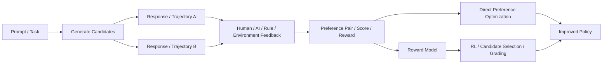
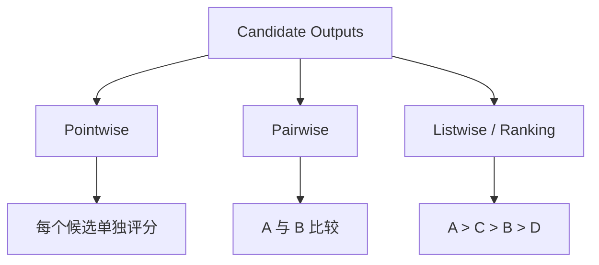
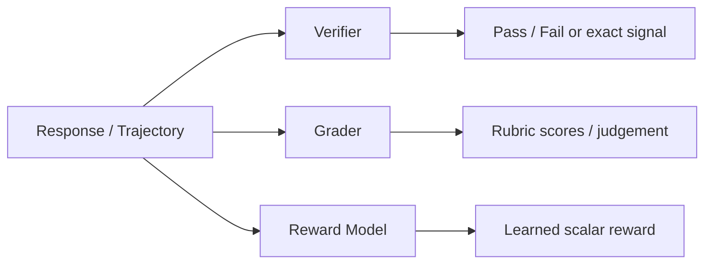
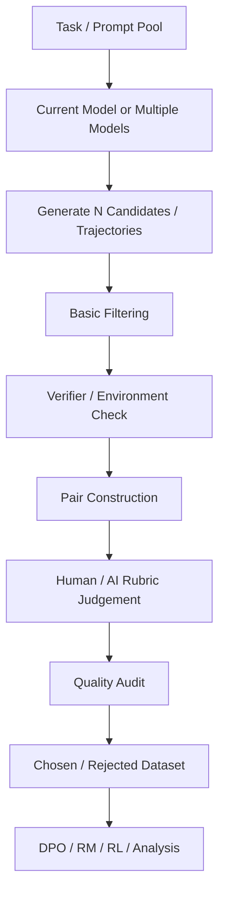

# 大模型与 Agent 数据知识体系

> 用途：系统学习“大模型 / Agent 中的数据工作到底在做什么”，覆盖训练数据、偏好数据、Reasoning 数据、Agent trajectory、合成数据、数据筛选、Eval / Benchmark 与数据飞轮。
>
> 维护方式：按“层 → 章 → 节”逐步补全。先建立统一概念和完整地图，再逐章深入到数据结构、生产方法、评价指标、工程流程、常见失败模式与面试问题。
>
> 当前版本：V1.2（2026-10-16）
>
> 关联文档：[`Agent_Knowledge_System.md`](./Agent_Knowledge_System.md)

---

# 0. 这套知识体系到底研究什么？

很多岗位会写：

- 大模型数据
- AI Data
- Agent 数据
- 数据策略
- 数据生产
- 数据合成
- 数据飞轮
- 模型评测 / Benchmark

如果只把它理解成“收集数据、清洗数据、人工标注”，会低估现在大模型数据工作的范围。

在传统监督学习里，一个数据样本经常可以抽象成：

```text
x → y
```

例如：

```text
图片 → 类别
文本 → 情感标签
问题 → 标准答案
```

而在今天的大模型系统里，一个“数据单元”可能是：

```text
Instruction
   ↓
Response
```

也可能是：

```text
Prompt
 ├── Response A
 └── Response B
        ↓
Preference: B > A
```

还可能是一条推理过程：

```text
Problem
  ↓
Reasoning State 1
  ↓
Reasoning State 2
  ↓
Reasoning State 3
  ↓
Final Answer
```

到了 Agent，更常见的是完整交互轨迹：

```text
Task
 ↓
State
 ↓
Action / Tool Call
 ↓
Observation
 ↓
New State
 ↓
Action
 ↓
...
 ↓
Final Outcome
```

因此，本体系采用一个更一般的定义：

> **大模型 / Agent 数据，本质上是在设计模型能够从中获得什么信息、什么反馈和什么学习信号。**

换句话说，“做数据”的核心已经逐渐从：

> 给样本打标签

转向：

> **定义任务 → 构造经验 → 提供反馈 → 判断成败 → 选择真正值得学习的数据。**

---

## 0.1 一张总图：从“数据样本”到“模型改进闭环”

```text
真实用户 / 目标能力 / 产品需求
            ↓
       Capability Definition
            ↓
         Task Design
            ↓
 ┌──────────┴──────────┐
 ↓                     ↓
Real Data         Synthetic Data
真实数据             合成数据
 └──────────┬──────────┘
            ↓
         Rollout
            ↓
   Response / Reasoning /
      Agent Trajectory
            ↓
 ┌──────────┴──────────┐
 ↓                     ↓
Grading              Analysis
评价/打分             错误分析
 ↓                     ↓
Training Data       Eval Set
 ↓                     ↓
SFT / DPO / RL      Regression
 └──────────┬──────────┘
            ↓
         New Model
            ↓
         New Rollout
            ↺
```

这张图里最重要的是：**数据不是流水线的起点，而是闭环中的中间产物。**

同一条模型轨迹，可能同时被用作：

- 失败分析材料；
- Benchmark case；
- SFT 样本；
- preference pair；
- reward / verifier 训练数据；
- hard case seed；
- 下一轮 synthetic data 的生成条件。

因此现代数据工作经常同时横跨：**模型、Agent、Eval、数据分析与工程系统。**

---

# 0.2 全体系分层

整套知识体系暂分为五层。

```text
I. Data Objects & Learning Signals
   数据对象与学习信号
                ↓
II. Data Production & Synthesis
    数据生产与合成
                ↓
III. Agent Tasks, Environments & Trajectories
     Agent 任务、环境与轨迹
                ↓
IV. Data Quality, Evaluation & Grading
    数据质量、评测与判分
                ↓
V. Data Flywheel & Data Strategy
   数据飞轮与数据策略
```

它们分别回答五个问题：

1. **模型到底在从什么样的数据中学习？**
2. **这些数据是怎么被生产出来的？**
3. **Agent 数据为什么和普通问答数据不一样？**
4. **我们怎么知道一条数据是对的、有价值的、没有污染的？**
5. **怎样把一次实验变成可持续的数据改进闭环？**

---

# I. Data Objects & Learning Signals

> 本层解决最基础的问题：**“大模型数据”究竟有哪些类型，它们分别向模型提供什么学习信号？**

---

# 1. 从 Sample 到 Trajectory：先理解“数据对象”

## 1.1 Dataset、Sample、Task、Episode、Trajectory 分别是什么？

这些词经常混用，但在 Agent 场景中最好区分。

### Dataset

一组数据对象的集合。

```text
Dataset
├── Sample 1
├── Sample 2
├── Sample 3
└── ...
```

例如 MATH、GSM8K、HumanEval 都可以看作 dataset。

---

### Sample / Example

一个相对独立的数据实例。

普通 SFT 中可能是：

```json
{
  "instruction": "解释什么是梯度下降",
  "response": "梯度下降是一种……"
}
```

此时 sample 基本就是一个 input-output pair。

---

### Task

Task 更强调：**希望模型完成什么目标。**

例如：

```text
“找到订单 #1847，并判断它是否满足退款条件。”
```

这里标准答案可能并不是一段固定文本，而是一个目标状态。

Agent 场景下，Task 往往比 Question 更合适，因为模型需要“做事”，而不只是“回答”。

---

### Episode

一次从任务开始到终止的完整执行过程。

```text
Task
 ↓
Agent starts
 ↓
interaction...
 ↓
Success / Failure / Timeout
```

强化学习与 Agent 环境中经常使用这个词。

---

### Trajectory / Trace

Agent 在一次 episode 中实际走过的路径。

可以抽象成：

$$
\tau = (s_0, a_0, o_1, s_1, a_1, o_2, \ldots, s_T)
$$

其中：

- $s_t$：当前状态 State；
- $a_t$：Agent 的动作 Action；
- $o_{t+1}$：环境返回的 Observation；
- $\tau$：完整 trajectory。

最直观的例子：

```text
Task:
“查一下订单 1847 是否发货，如果没发货就取消。”

State 0
↓
Action: search_order(id=1847)
↓
Observation: status = pending
↓
State 1
↓
Action: cancel_order(id=1847)
↓
Observation: cancellation_success = true
↓
Final response: “订单已取消。”
```

这里真正的数据不只是最终一句“订单已取消”，而是整条执行轨迹。

---

## 1.2 为什么 Agent 时代必须从“答案”升级到“轨迹”？

看下面两个 Agent：

### Agent A

```text
User: 把明天下午三点的会议改到周五下午三点。

Agent:
calendar.search(...)
calendar.update(...)

Final:
已经帮你改好了。
```

### Agent B

```text
User: 把明天下午三点的会议改到周五下午三点。

Agent:
calendar.search(...)

Final:
已经帮你改好了。
```

如果只看最终回答，两者几乎完全一样。

但真实任务结果完全不同：

```text
Agent A → task success
Agent B → task failure
```

因此：

> **Agent 的正确性不能仅由最终自然语言回答决定，而必须结合工具调用、环境状态变化和最终任务完成状态。**

这也是 Agent Data 与传统 instruction-response data 最重要的区别之一。

---

## 1.3 一条 Agent 数据通常包含哪些字段？

一个较完整的 Agent sample 可能包含：

```text
Task
├── Initial Environment State
├── Available Tools
│   ├── tool name
│   ├── tool description
│   └── argument schema
│
├── Trajectory
│   ├── model message
│   ├── tool call
│   ├── tool arguments
│   ├── tool result / observation
│   └── repeated...
│
├── Final Response
│
├── Final Environment State
│
└── Labels / Rewards
    ├── task_success
    ├── tool_correctness
    ├── policy_violation
    ├── efficiency
    └── grader_feedback
```

因此 Agent 数据天然比普通问答数据更结构化。

---

## 1.4 数据的四个基本维度

理解任何一种大模型数据，都可以先问四个问题。

### 维度一：Source —— 数据从哪里来？

```text
Human-written
真实用户日志
专家编写
公开数据集
模型生成 Synthetic Data
模型 Rollout
多模型互评
环境自动生成
```

### 维度二：Supervision —— 给了什么监督信号？

```text
正确答案
示范轨迹
A > B 偏好
标量 Reward
步骤级标签
Verifier 结果
环境成功 / 失败
无标签数据
```

### 维度三：Granularity —— 监督到哪一级？

```text
Token-level
Step-level
Response-level
Trajectory-level
Task-level
```

例如“答案对了”是 outcome-level；而逐步判断哪一步开始出错，则属于 process / step-level supervision。

### 维度四：Purpose —— 这批数据拿来干什么？

```text
Pretraining
SFT
Preference Optimization
Reward Model
RL
Verifier / Grader
Evaluation
Failure Analysis
Regression Test
Data Synthesis Seed
```

同一条数据可能被转换后服务多个目的。

---

## 1.5 “标签”只是 Learning Signal 的一种

传统数据工作经常问：

> 标签是什么？

到了大模型阶段，更应该问：

> **模型从这条数据里到底能得到什么 learning signal？**

常见信号包括：

### 1. Demonstration / Imitation Signal

告诉模型：遇到这种输入，应该这样做。

典型形式：SFT。

```text
x → y*
```

### 2. Preference Signal

告诉模型：A 和 B 相比，B 更好。

```text
x
├── y_A
└── y_B

B > A
```

典型用途：DPO、preference optimization、reward modeling。

### 3. Scalar Reward

告诉模型：

```text
这一条轨迹得分 = 0.8
```

或者：

```text
success = 1
failure = 0
```

常用于 RL / policy optimization。

### 4. Process Supervision

不只看最终答案，而评价中间过程。

```text
Step 1: ✓
Step 2: ✓
Step 3: ✗
Step 4: 基于错误继续推导
```

它可以用于 reasoning verifier、process reward model、错误定位等。

### 5. Environment Feedback

这是 Agent 特别重要的一类信号。

例如：

```text
Tool Call:
transfer_money(amount=100)

Observation:
insufficient_balance
```

环境本身告诉模型动作没有成功。

再例如：

```text
database state before = meeting at Monday

database state after = meeting at Friday
```

这种 state transition 可以直接作为任务是否完成的证据。

---

## 1.6 Outcome Supervision 与 Process Supervision

### Outcome Supervision

只关心最终结果。

```text
Final Answer = Correct
```

优点：

- 标注便宜；
- 很多数学、代码任务可以自动判分；
- 易于大规模扩展。

问题：

- 不知道哪里做对了；
- 不知道哪里开始错；
- 可能出现“过程错误但碰巧答案正确”；
- 对长 Agent trajectory 的 credit assignment 很弱。

### Process Supervision

评价中间步骤。

```text
State 0 → Action 0 : correct
State 1 → Action 1 : unnecessary
State 2 → Action 2 : wrong tool
```

它能回答：Agent 是不会做，还是某一步选错了？

但成本更高，因为需要定义：

- 什么叫一个 step；
- 哪一步应该评分；
- 是否存在多条同样正确的路径；
- 标注者如何判断中间动作的合理性。

---

## 1.7 数据不只是“让模型学”，也可以“让人理解模型”

### Training-oriented Data

目标是改变模型。

```text
Data
 ↓
Training / Fine-tuning / Optimization
 ↓
New Model
```

### Evaluation-oriented Data

目标是测量模型。

```text
Data
 ↓
Run Model
 ↓
Measure Capability / Failure
```

但现实中二者经常形成循环：

```text
Eval 发现失败
   ↓
Failure Mining
   ↓
变成 Training Data
   ↓
新模型
   ↓
再次 Eval
```

因此成熟的数据体系通常不会把“训练数据团队”和“评测数据团队”完全割裂来看。

---

## 1.8 一句话理解现代大模型数据

```text
传统 ML：
数据 = 输入 + 标签

LLM Post-training：
数据 = 指令 + 响应 + 偏好 / Reward

Agent：
数据 = 任务 + 环境 + 轨迹 + 结果 + 反馈
```

再进一步：

> **数据工作的核心对象，从 Example 逐步扩大到了 Experience。**

---

## 1.9 本章关键词

| 术语 | 核心含义 |
|---|---|
| Dataset | 一组数据实例 |
| Sample / Example | 一个独立数据实例 |
| Task | 希望模型完成的目标 |
| Episode | 一次从开始到终止的完整执行 |
| State | 当前可用于决策的信息状态 |
| Action | Agent 采取的动作 |
| Observation | 环境对动作返回的结果 |
| Trajectory / Trace | 一次完整执行路径 |
| Outcome | 最终任务结果 |
| Learning Signal | 模型从数据中获得的学习反馈 |
| Outcome Supervision | 只监督最终结果 |
| Process Supervision | 对中间过程提供监督 |
| Verifier | 判断结果或过程是否满足条件的验证器 |
| Grader | 对模型输出 / trajectory 评分的评价器 |

---

## 1.10 常见误区

### 误区 1：大模型数据 = 文本语料

不对。Agent 数据还可能包括 JSON tool call、API 参数、网页状态、文件状态、数据库状态、GUI 操作、execution result、reward 和 grader output。

### 误区 2：有标准答案的数据才有用

不对。Preference、reward、环境反馈、pairwise comparison 都可以提供有效监督。

### 误区 3：最终答案正确，Agent 就执行正确

不对。Agent 可能根本没有执行工具、调错对象、调用失败、没有验证执行结果，却在最终自然语言中声称已经成功。因此必须检查真实 environment state。

### 误区 4：数据越多越好

不一定。真正需要研究的是：

```text
Quality
Diversity
Difficulty
Verifiability
Coverage
Novelty
Information Density
```

后续“数据筛选与 Data Curation”会专门展开。

---

# 2. Pretraining、Instruction、SFT 与 Post-training Data

> 本章目标：把“大模型训练数据”这个经常被混在一起的概念拆开。
>
> 核心问题：**模型从“会续写文本”到“会听懂指令、遵循约束、调用工具并完成任务”，各阶段的数据究竟在教它什么？**

如果只记一句话，可以先记：

```text
Pretraining：学“世界和语言长什么样”
Instruction / SFT：学“用户让我做事时应该怎么回应”
Preference / RL：学“多个可行行为里哪一种更值得选择”
Agent Data：学“在环境里如何连续决策并真正把事情做完”
```

但现实中这些边界并不是绝对的。现代模型会使用 continued pretraining、instruction tuning、SFT、preference optimization、RL、verifiable reward 等多种阶段，数据也会交叉复用。理解它们时，不要只按“训练算法名字”分类，更要看**这批数据提供了什么监督信号**。

---

## 2.1 Pretraining Data：先学会预测“接下来会出现什么”

### 2.1.1 Pretraining Data 是什么？

最经典的 decoder-only LLM 预训练目标是 next-token prediction。

给定 token 序列：

$$
x_1, x_2, \ldots, x_T
$$

模型学习最大化：

$$
\sum_{t=1}^{T} \log P(x_t \mid x_{<t})
$$

或者等价地最小化 token-level cross entropy。

此时数据通常不是：

```text
Question → Answer
```

而只是大量自然产生的 token sequence，例如：

```text
网页文章
书籍
百科
论坛
新闻
代码仓库
论文
文档
问答网站
多语言文本
数学内容
```

模型不需要显式知道“这条数据是在教历史知识还是教语法”。它只是在巨量语料中学习统计规律、语言结构、事实关联、代码模式、推理模式和世界知识。

因此：

> **Pretraining Data 的基本监督信号不是人工标签，而是文本本身的下一个 token。**

---

### 2.1.2 为什么预训练数据规模可以特别大？

因为它天然属于 self-supervised learning。

原始文本：

```text
深度学习模型通常通过梯度下降优化参数。
```

可以自动变成许多训练位置：

```text
深度 → 学习
深度 学习 → 模型
深度 学习 模型 → 通常
...
```

不需要人工逐条标注。

这解释了一个重要现象：

```text
Pretraining
数据量巨大
人工标注比例低
监督信号自动产生

Post-training
数据量通常小得多
但单条数据更贵、更有目的性
```

所以“数据量”不能脱离训练阶段比较。

---

### 2.1.3 预训练数据常见来源

可以粗略分成：

#### Web Data

```text
网页
论坛
博客
新闻
知识站点
公开文档
```

优势是规模大、覆盖广；问题是噪声、广告、重复、SEO 文本、低质生成内容和隐私/版权风险都更明显。

#### Books / Long-form Text

更容易提供：

- 长篇连贯结构；
- 复杂叙事；
- 跨段依赖；
- 高质量自然语言。

#### Code

代码数据不只教“写代码”，还提供非常强的结构信号：

```text
syntax
function dependency
API usage
tests
error handling
program structure
```

这也是为什么代码能力与 Agent 的工具调用、结构化输出、程序化推理有一定关联。

#### Academic / Technical Data

包括论文、教材、技术文档、规范、专业资料等。它们对专业领域知识、符号系统、推理表达和术语覆盖很重要。

#### Multilingual Data

决定模型对不同语言的覆盖程度。这里不是“只要混进去就行”，还要处理语言识别、语种比例、翻译腔、跨语言重复和资源极不平衡的问题。

---

### 2.1.4 预训练数据真正的工作，不是“下载完就训练”

一个简化 pipeline 往往更像：

```text
Raw Sources
    ↓
Ingestion / Parsing
    ↓
Normalization
    ↓
Language / Domain Identification
    ↓
Quality Filtering
    ↓
Safety / Privacy Filtering
    ↓
Deduplication
    ↓
Contamination Check
    ↓
Sampling / Mixture
    ↓
Tokenization
    ↓
Training Shards
```

每一步都可能改变最终模型能力。

例如：

- 网页解析错了，会留下导航栏、乱码和广告；
- 去重过弱，会让高频网站被重复记忆；
- 去重过强，也可能误删真正不同但主题相近的文本；
- 质量过滤器偏英语风格，可能误伤其他语言；
- 代码过滤过重，会让模型丢失长尾 API；
- benchmark contamination 没查好，会让评测分数失真。

因此预训练数据工程的核心不是简单 ETL，而是：

> **通过数据分布设计，塑造基础模型能看到怎样的世界。**

---

### 2.1.5 Deduplication 为什么重要？

重复数据会带来至少三个问题。

#### 1. 浪费训练预算

如果同一篇文章出现 100 次，模型相当于反复花 token 预算学习同一个东西。

#### 2. 扭曲真实分布

某个网站因为爬虫结构被重复抓取，并不意味着这个知识在真实世界里应该占 100 倍权重。

#### 3. 放大记忆与 contamination

如果 benchmark 题目或其近似版本反复出现，模型评测时可能是在“见过题”而不是泛化。

去重可以发生在多个层级：

```text
exact duplicate
near duplicate
paragraph-level duplicate
document-level duplicate
semantic duplicate
```

后面 Data Curation 会详细展开。

---

### 2.1.6 Pretraining contamination 是什么？

假设某 benchmark 的测试题出现在预训练语料里：

```text
Benchmark test item
        ↓
进入 pretraining corpus
        ↓
模型训练时见过
        ↓
Benchmark evaluation
```

那么测试分数可能混入记忆效应。

这里需要区分：

- exact contamination：测试题原文直接出现；
- near contamination：轻微改写版本出现；
- solution contamination：题目或答案解析出现；
- benchmark-family exposure：没见过该测试题，但见过大量高度模板化同源题。

因此 contamination 不是简单 grep 一次就能完全解决的问题。

---

### 2.1.7 Pretraining Data 与 Instruction Data 的根本区别

看两个例子。

#### Pretraining-like text

```text
牛顿第二定律描述了物体受到的合外力与加速度之间的关系……
```

#### Instruction Data

```text
User:
请用高中生能理解的方式解释牛顿第二定律。

Assistant:
你可以把它理解成……
```

两者都可能教模型“牛顿第二定律”，但学习信号不同。

前者主要让模型学习：

> **什么文本通常接在什么文本后面。**

后者额外让模型学习：

> **当用户以这种方式提出需求时，应该采取怎样的响应行为。**

因此不能简单认为：

> “预训练里有大量问答网页，所以就不需要 instruction tuning。”

模型在预训练阶段可能学会了问答文本的统计模式，但未必稳定学会**把当前用户指令当作需要遵循的任务**。

---

## 2.2 Instruction Data：把“文本续写”变成“任务响应”

### 2.2.1 什么是 Instruction Data？

最基本结构是：

```text
Instruction
    ↓
Desired Response
```

例如：

```json
{
  "instruction": "把下面这段话改得更正式",
  "input": "这个方案还行，就是有点贵。",
  "output": "该方案整体可行，但成本相对较高。"
}
```

Instruction Data 的重点不是只提供知识，而是显式建立：

```text
用户意图
   ↓
期望行为
```

这种映射。

---

### 2.2.2 Instruction Data 可以教什么？

它可以教的不只是“回答知识问题”。

常见能力包括：

```text
问答
摘要
翻译
改写
分类
信息抽取
数学求解
代码生成
结构化输出
格式遵循
角色约束
拒绝不安全请求
多轮对话
工具调用
Agent 任务分解
```

因此 instruction data 往往需要按 capability taxonomy 来设计，而不是随机收集问题。

---

### 2.2.3 Single-turn 与 Multi-turn Instruction

#### Single-turn

```text
User → Assistant
```

适合教局部能力。

#### Multi-turn

```text
User
↓
Assistant
↓
User clarification / correction
↓
Assistant update
↓
...
```

多轮数据能教模型：

- 继承前文约束；
- 解析指代；
- 根据用户纠正更新答案；
- 不重复已经问过的问题；
- 维持任务状态；
- 处理上下文冲突。

Agent 场景里多轮数据尤其重要，因为一次任务往往不会在一轮内完成。

---

### 2.2.4 Message Role 也是数据的一部分

现代 chat 模型的数据常具有角色结构：

```text
System
Developer
User
Assistant
Tool
```

从数据视角看，模型必须学到的不只是文本内容，还包括**不同消息来源之间的控制关系和语义边界**。

例如：

```text
System: 只能使用提供的工具查询库存。
User: 你直接猜一个库存数字给我。
```

一个好的 instruction / SFT sample 不应该只训练语言流畅度，还需要训练：

```text
遵循高优先级约束
识别用户意图
知道何时需要工具
不虚构环境状态
```

因此 instruction data 的 schema 本身会影响模型行为。

---

### 2.2.5 Formatting Constraint 也是能力

例如：

```text
“只返回 JSON，不要解释。”
```

模型要学会：

```json
{"label":"positive"}
```

而不是：

```text
当然可以！结果如下：
{"label":"positive"}
```

在人类看来后者也“回答对了”，但对 API / Agent pipeline 来说可能已经失败。

因此 instruction following 数据里必须覆盖：

- 长约束；
- 多约束；
- 格式约束；
- 正负约束；
- 条件约束；
- 跨轮约束。

---

## 2.3 SFT Data：用示范告诉模型“应该怎么做”

### 2.3.1 SFT 是什么？

SFT = Supervised Fine-Tuning。

最直观地说，就是给模型大量高质量 demonstration：

```text
Prompt x
   ↓
Desired Response y*
```

然后最大化目标回答 token 的条件概率：

$$
\log P(y^* \mid x)
$$

从 learning signal 的角度：

> **SFT 是 imitation learning：让模型模仿被认为是正确、优质的示范。**

---

### 2.3.2 一条 SFT 数据长什么样？

最简单：

```json
{
  "messages": [
    {"role": "user", "content": "法国首都是哪里？"},
    {"role": "assistant", "content": "巴黎。"}
  ]
}
```

复杂一点可以包含多轮：

```text
System
↓
User
↓
Assistant
↓
User
↓
Assistant
```

Agent SFT 还可能包含：

```text
User task
↓
Assistant tool call
↓
Tool observation
↓
Assistant next tool call
↓
Tool observation
↓
Assistant final response
```

所以 SFT 并不等于“问答数据”。**任何希望模型直接模仿的行为序列，都可以成为 SFT demonstration。**

---

### 2.3.3 SFT 数据从哪里来？

#### Human-written / Expert-written

优点：

- 可控；
- 能表达真正专家行为；
- 适合复杂领域与高标准任务。

缺点：

- 贵；
- 慢；
- 难扩展；
- 标注者风格可能高度集中。

#### Existing High-quality Data

例如公开 instruction 数据、领域数据、历史产品数据。

问题是需要特别关注：

- license；
- 数据质量；
- 训练/评测泄漏；
- schema 是否一致；
- 是否真的适配当前模型和产品目标。

#### Synthetic Data

常见流程：

```text
Task / Seed
   ↓
Teacher Model
   ↓
Candidate Response
   ↓
Filter / Verify
   ↓
SFT Data
```

现代 SFT 中 synthetic data 很常见，但核心不是“模型生成了就能训”，而是**生成 + 验证 + 筛选**。

#### Successful Rollout

对于 Agent：

```text
任务
↓
模型跑出若干 trajectory
↓
环境验证 success
↓
筛掉异常路径
↓
成功轨迹作为 demonstration
```

这会自然连接到后面的 rejection sampling 和 agent trajectory data。

---

### 2.3.4 SFT 最擅长教什么？

SFT 非常适合教：

#### 1. 输出格式

```text
JSON
XML
tool call schema
固定模板
```

#### 2. 交互习惯

例如：

```text
什么时候先澄清
什么时候直接回答
什么时候调用工具
怎样引用工具结果
```

#### 3. 行为模式

```text
遇到代码题 → 写代码 + 测试
遇到搜索任务 → 先查证再回答
遇到工具错误 → 根据 observation 修正
```

#### 4. 风格

例如简洁、专业、结构化、避免废话。

#### 5. 基础任务能力的激活与对齐

预训练模型可能“知道”某些知识或模式，但 SFT 帮助它把这些能力稳定地映射到用户指令上。

---

### 2.3.5 Positive-only Imitation 的局限

SFT 常常只告诉模型：

> “这是一个好答案，请模仿。”

但没有直接告诉模型：

> “这个看起来也合理的答案为什么更差？”

例如：

```text
Prompt

Good response A
Bad-but-plausible response B
```

如果训练集只有 A，模型能学到 A 的模式，但并没有显式获得：

```text
A > B
```

这种相对偏好信号。

因此 SFT 的典型局限包括：

- 难表达“两个都能做，但哪个更好”；
- 难利用大量失败 candidate 的信息；
- 对细微风格和行为偏好的区分能力有限；
- 对 long-horizon credit assignment 支持有限。

这就是为什么 SFT 后面经常还会接 Preference Optimization / RL。

---

### 2.3.6 SFT 数据不是越“完美”越好

一个常见误区是：

> 只要所有回答都非常完美，SFT 就一定最好。

实际要考虑目标分布。

如果线上用户经常给出：

```text
错别字
模糊需求
半句话
多约束
互相冲突的要求
工具失败
```

而训练数据全部是：

```text
清晰、完整、标准、单轮 instruction
```

模型会面临 distribution shift。

因此高质量不等于“干净得不真实”。高质量数据应该是：

> **真实覆盖目标行为分布，同时拥有可靠监督信号。**

---

## 2.4 Post-training Data：从“会生成”到“会按目标行为”

### 2.4.1 Post-training 是什么？

广义上，pretraining 之后为了塑造模型行为进行的训练，都可以归到 post-training 讨论范围。

一个非常简化的框架是：

```text
Base Model
   ↓
SFT
   ↓
Preference / Reward Modeling
   ↓
RL / Preference Optimization
   ↓
Capability / Safety / Tool-use refinement
   ↓
Deployed Model
```

现实中的训练 recipe 可能并不会严格按这个顺序，也可能循环多轮。

---

### 2.4.2 Post-training Data 不等于 SFT Data

这是非常容易混淆的一点。

```text
SFT Data ⊂ Post-training Data
```

Post-training 还可能包括：

```text
Preference pairs
Ranked candidates
Reward labels
Critiques
Step-level process labels
RL rollout
Verifier outcome
Tool execution feedback
Safety adversarial data
Agent success / failure trajectory
```

因此，当岗位说“负责 post-training data”时，实际工作可能远远超过 instruction-response 标注。

---

### 2.4.3 Post-training 的核心：从“模仿答案”升级到“优化行为”

可以这样理解：

#### SFT 问：

> 一个好示范长什么样？

#### Preference 问：

> 两个答案里哪个更好？

#### Reward 问：

> 这条行为到底有多好？

#### RL / rollout 问：

> 当前模型自己会走出哪些路径，哪些路径值得强化？

#### Agent environment 问：

> 这条轨迹有没有真实完成任务？

所以 post-training data 越往后，越接近**模型当前策略产生的实际行为分布**。

---

### 2.4.4 On-policy 与 Off-policy 数据直觉

不用先陷入严格 RL 定义，可以先建立一个数据直觉。

#### Off-policy-like

数据主要来自别的分布：

```text
人工专家答案
teacher model 输出
历史模型 trajectory
公开数据集
```

当前模型只是去学习它们。

#### On-policy-like

让**当前模型本身**去 rollout：

```text
Current Model
    ↓
Generate candidates / trajectories
    ↓
Reward / Verify
    ↓
Use feedback to improve Current Model
```

优点是数据直接暴露当前模型真正会犯的错误。

这也是为什么后续 Agent data flywheel 会特别关注线上 trace 和 current-policy rollout。

---

### 2.4.5 Verifiable Tasks 为什么越来越重要？

如果任务结果可以自动验证：

```text
数学答案 → symbolic / exact verifier
代码 → unit tests / execution
Agent → final environment state
数据库任务 → SQL / state check
网页任务 → target state
```

那么可以低成本跑大量 rollout：

```text
1 task
↓
N trajectories
↓
automatic verification
↓
success / failure
↓
training signal
```

这比“每一条都请人工专家判断”更容易扩展。

因此现在很多 reasoning / agent data pipeline 都在追求：

> **生成成本可控 + 结果可验证 + 能大规模 rollout。**

---

## 2.5 Data Mixture：为什么“配数据”本身就是研究问题？

假设你有：

```text
数学数据 100 万
代码数据 80 万
通用问答 500 万
多轮对话 20 万
工具调用 5 万
安全数据 10 万
```

训练时直接全部拼起来，并不意味着模型会得到理想能力。

真正的问题是：

> **每一种数据应该以多大权重进入训练？**

这就是 mixture design。

---

### 2.5.1 为什么不能简单按原始数据量采样？

假设：

```text
General chat = 90%
Tool-use = 1%
```

如果严格按原始比例训练，模型几乎很少见到 tool-use。

结果可能是：

> 明明收集了 10 万条工具数据，但它在总 token 中被淹没，能力提升很小。

因此常用方法包括：

```text
oversampling
undersampling
source weighting
domain weighting
capability weighting
```

---

### 2.5.2 Token 比 Sample Count 更接近真实训练权重

1000 条短分类数据与 1000 条长 Agent trajectory，不是同一个量级。

例如：

```text
Dataset A
1000 samples × 100 tokens = 100k tokens

Dataset B
1000 samples × 5000 tokens = 5M tokens
```

如果只看 sample count，会严重误判 mixture。

所以需要同时跟踪：

```text
sample count
token count
source share
capability share
language share
length distribution
```

---

### 2.5.3 Domain Balancing

例如医学模型不应该简单变成：

```text
99% 医学
1% 通用能力
```

因为可能造成 general capability regression。

所以数据配比常常是在优化：

```text
目标领域提升
        vs
通用能力保持
```

这就是典型 trade-off。

---

### 2.5.4 Curriculum：数据顺序也可能重要

Curriculum learning 的直觉是：

```text
基础 → 复杂
简单 → 困难
短任务 → 长任务
单工具 → 多工具
```

例如 Agent 训练可以设计成：

```text
Stage 1: 单步 function calling
Stage 2: 两步工具链
Stage 3: 多工具依赖
Stage 4: 长时程任务 + failure recovery
```

但 curriculum 不是天然优于随机混合；是否有效必须通过实验验证。

---

### 2.5.5 Mixture 的核心不是“平均”，而是目标函数

更正确的思考是：

```text
我们希望优化哪些能力？
↓
每种能力目前差多少？
↓
什么数据最可能提供有效学习信号？
↓
训练预算有多少？
↓
如何配比？
```

也就是：

> **Mixture 是一种资源分配问题。**

---

## 2.6 Continued Pretraining、SFT、Preference：不要只看数据格式

一条文本长得像问答，不意味着它一定是 SFT；一条自然语言文档也可能用于 continued pretraining。

判断数据类型时应问：

```text
训练目标是什么？
loss 作用在哪些 token？
模型是在模仿 demonstration，还是比较 candidate？
有没有 reward / verifier？
数据是当前模型 rollout 的吗？
```

一个简化对照表：

| 阶段 | 典型数据 | 主要学习信号 | 最主要作用 |
|---|---|---|---|
| Pretraining | 海量 token sequence | next-token prediction | 语言、知识、通用模式 |
| Continued Pretraining | 领域原始语料 | next-token prediction | 增强领域分布覆盖 |
| Instruction Tuning | instruction-response | demonstration | 建立指令到行为映射 |
| SFT | 高质量目标行为 | imitation | 稳定行为、格式和能力 |
| Preference Optimization | chosen / rejected | relative preference | 学“哪个更好” |
| Reward Modeling | candidate + score/rank | reward signal | 学评价函数 |
| RL / Verifiable RL | rollout + reward | outcome / reward | 优化当前策略 |
| Agent Training | task + environment + trajectory | action/outcome/process signal | 学连续决策与任务完成 |

---

## 2.7 一个完整案例：教模型学会“查库存再回答”

假设目标能力是：

> 用户问商品库存时，模型不能凭记忆猜，要调用库存工具并根据真实返回回答。

### 只靠 Pretraining 会怎样？

模型可能见过：

```text
“某商品通常有库存……”
```

于是它学会生成看起来合理的库存回答，但它并不知道当前真实库存。

### 加 SFT

训练示范：

```text
User:
A100 显卡还有货吗？

Assistant tool call:
check_inventory(product="A100")

Tool:
{"stock": 3}

Assistant:
目前还有 3 件库存。
```

模型开始学会：

```text
库存问题 → 调库存工具 → 基于 observation 回答
```

### 再加入失败数据 / Preference

候选 A：

```text
我猜应该还有货。
```

候选 B：

```text
先调用 check_inventory，再根据返回回答。
```

标签：

```text
B > A
```

模型进一步学到：

> “直接猜”比“真实查询”差。

### 再做 Agent rollout

让当前模型自己处理 1 万个库存任务：

```text
成功
漏调用工具
参数错误
调用后忽略 observation
工具失败后仍声称成功
```

环境自动判定最终 answer 是否与 inventory state 一致。

此时数据工作已经从：

> 写标准答案

升级成：

> **构造任务 → 运行模型 → 收集轨迹 → 验证状态 → 分析失败 → 回流训练。**

这就是后面 Agent Data Flywheel 的雏形。

---

## 2.8 一条训练数据到底“好不好”，看什么？

不能只问“有没有语法错误”。

对于 SFT / Post-training Data，可以从以下维度检查：

### Correctness

答案、工具调用、状态变化是否真实正确？

### Instruction Following

是否真正满足用户所有显式约束？

### Behavioral Validity

这个行为是不是我们希望模型以后模仿的？

例如一个答案事实正确，但先胡乱调用了 8 次无关工具，也不应作为理想 Agent demonstration。

### Difficulty

是不是模型已经 99.9% 都会了？如果是，新增 10 万条可能边际价值很低。

### Diversity

是否只是模板替换？

```text
查询订单 1
查询订单 2
查询订单 3
...
```

表面上有 1 万条，实际 decision pattern 只有一种。

### Coverage

是否覆盖真正重要的 failure mode？

### Verifiability

标签能否可靠验证？

### Naturalness

是否符合真实用户分布，而不是全是模型生成的“教科书式问题”？

### Learning Value

最终要问：

> **这条数据加入训练后，是否有机会改变模型在目标能力上的行为？**

这比“这条数据看起来不错”更重要。

---

## 2.9 常见失败模式

### 失败 1：把所有“训练数据”都叫 SFT Data

会混淆 demonstration、preference、reward、rollout 等完全不同的学习信号。

### 失败 2：Teacher 越强，Synthetic Data 就一定越好

Teacher 也会带来系统性偏差、风格单一和错误模式。强 teacher 不等于自动得到高价值 student data。

### 失败 3：只看数据条数，不看 token 和 decision diversity

Agent trajectory 往往很长，只看 sample count 容易误判实际训练权重；模板化 synthetic data 又可能造成“条数很多、决策模式很少”。

### 失败 4：只做正例，不分析失败

如果当前模型最常犯的是：

```text
漏工具调用
```

但新增数据都只是普通高质量问答，那么数据并没有瞄准真正瓶颈。

### 失败 5：训练集质量很好，但和线上分布不一致

例如线上大量是模糊、多轮、短句、错别字、工具错误，而训练集全是标准单轮问题。

### 失败 6：训练数据和 Eval 混在一起

一旦 benchmark case 被有针对性地加入训练，再使用同一 benchmark 宣称能力提升，就可能把“泛化提升”和“记住测试集”混淆。

### 失败 7：Data Mixture 没有版本记录

如果最终只知道：

```text
“我们加了一批代码数据，效果涨了。”
```

却不知道：

```text
加了多少？
哪些 source？
多少 token？
采样权重多少？
过滤了什么？
模型版本是什么？
```

这个实验几乎无法复现，也无法沉淀为数据策略。

---

## 2.10 从数据岗位视角，这一章对应哪些实际工作？

可能是：

```text
抓取 / 接入原始语料
清洗 HTML / 文档
语言识别
质量打分
去重
PII / safety filtering
benchmark contamination 检查
instruction taxonomy 设计
SFT 样本生产
teacher model 批量生成
candidate filtering
数据配比
token 统计
训练集版本管理
训练前质量 audit
训练后 capability regression analysis
```

所以“做大模型数据”并不等于一个单独岗位动作，而是一整条从**数据来源 → 数据结构 → 学习信号 → 训练目标 → 效果验证**的链路。

---

## 2.11 本章关键词

| 术语 | 一句话理解 |
|---|---|
| Pretraining Data | 用于 next-token learning 的大规模原始语料 |
| Self-supervised Learning | 监督信号从数据本身自动构造 |
| Instruction Data | 显式描述“用户要求 → 期望响应”的数据 |
| SFT | 用高质量 demonstration 让模型模仿目标行为 |
| Continued Pretraining | 在目标领域语料上继续做语言模型训练 |
| Post-training | 预训练之后用于塑造能力和行为的一系列训练阶段 |
| Data Mixture | 多种数据源 / 能力数据的训练配比 |
| Oversampling | 提高某类数据在训练中的采样权重 |
| Curriculum | 按难度或能力阶段组织训练数据 |
| Contamination | 测试信息泄漏进入训练数据 |
| On-policy Rollout | 由当前策略自身生成训练经验 |
| Verifiable Task | 结果可通过规则、执行或环境状态可靠验证的任务 |

---

## 2.12 面试 / 自检问题

学完这一章至少应该能够回答：

1. **Pretraining Data 和 SFT Data 的根本区别是什么？**
2. **Instruction tuning 和 SFT 是完全同义的吗？**
3. **为什么 SFT 通常不够，还需要 preference / reward？**
4. **为什么 synthetic SFT data 不能 teacher 生成完直接用？**
5. **为什么 Agent 数据不能只统计 sample 数？**
6. **Data mixture 为什么会显著影响模型能力？**
7. **什么是 contamination，它为什么会让 benchmark 失真？**
8. **continued pretraining 和 SFT 分别适合解决什么问题？**
9. **为什么 current-model rollout 对后训练数据特别重要？**
10. **如果新增 10 万条数据模型没涨，你会从哪些角度排查？**

第 10 题可以使用一个通用分析框架：

```text
数据真的正确吗？
↓
数据覆盖目标 failure 吗？
↓
数据对当前模型有难度吗？
↓
数据在 mixture 中权重够吗？
↓
监督信号和目标行为一致吗？
↓
训练是否真的消费了这些数据？
↓
Eval 是否能测到预期能力？
↓
是否发生其他能力 regression？
```

这条链路以后会反复出现。

---

# 3. Preference Data、Reward 与 Feedback

> 本章目标：理解当“唯一正确答案”不存在，或者仅有一个好示范不足以定义理想行为时，如何用比较、评分、规则、环境结果等方式向模型提供更细的反馈。
>
> 核心问题：**SFT 告诉模型“可以这样做”，Preference / Reward 则进一步告诉模型“在多个可行行为中，哪一个更值得选择”。**

先建立一张总图：



这张图中最重要的一点是：**Feedback 是来源，Preference / Reward 是把反馈结构化之后形成的学习信号。**

---

## 3.1 为什么只有 SFT 还不够？

假设用户问：

```text
“帮我解释一下什么是梯度下降。”
```

我们有两个回答。

### Response A

```text
梯度下降是一种优化算法，通过沿损失函数梯度的反方向更新参数，以逐步减小损失。
```

### Response B

```text
梯度下降本质上是在寻找一个“下坡方向”。你可以把损失函数想象成一座山，模型每次根据当前位置的坡度往更低的地方移动一点。
```

这两个回答可能都正确。

如果只有 SFT，我们通常只能选择一个作为 demonstration：

```text
Prompt → Response B
```

但很多真实目标是相对的：

```text
哪个更容易懂？
哪个更简洁？
哪个更符合用户水平？
哪个更完整？
哪个更少废话？
```

这些问题没有一个天然唯一的标准文本。

因此需要一种新的监督方式：

> **不要求写出唯一完美答案，而是比较已有候选之间谁更符合目标。**

这就是 Preference Data 的基本思想。

---

## 3.2 Pairwise Preference：最经典的偏好数据

最基本的数据结构是：

```text
Prompt x
├── Chosen response y_w
└── Rejected response y_l

Label: y_w > y_l
```

其中：

- `chosen / winner`：更优候选；
- `rejected / loser`：较差候选；
- `>`：表示相对偏好，而不是绝对正确性。

典型 JSON 可以长这样：

```json
{
  "prompt": "用一句话解释过拟合。",
  "chosen": "过拟合是模型把训练数据学得过于具体，以至于在新数据上泛化变差。",
  "rejected": "过拟合就是模型训练得太好了。"
}
```

这里 `rejected` 并不一定完全胡说八道。恰恰相反，**高价值 preference pair 往往来自“两个都像样，但一个明显更符合目标”的边界案例。**

---

### 3.2.1 Preference 与分类标签有什么不同？

分类标签通常回答：

```text
这条属于哪一类？
```

而 preference 回答：

```text
在同一个 context 下，这两个候选谁更好？
```

因此 preference 天然依赖 context。

例如：

```text
Response A = 很简短
Response B = 很详细
```

对于：

```text
“请一句话回答”
```

A 可能更好。

对于：

```text
“请详细讲解给初学者”
```

B 可能更好。

所以 Preference Data 的核心对象不是孤立回答，而是：

```text
Context + Candidate A + Candidate B + Evaluation Objective
```

---

### 3.2.2 Chosen 不等于“绝对正确”

这是非常重要的概念。

如果 A 和 B 都错，但 A 错得更少，标注可能仍然是：

```text
A > B
```

这意味着：

> **Preference 是相对信号，而不是天然的 correctness certificate。**

因此在数学、代码、工具执行等可验证任务中，最好不要只依赖“看起来更好”的偏好，而应把 correctness / execution outcome 纳入 rubric 或 verifier。

---

### 3.2.3 Tie / Both Bad / Cannot Judge 也很重要

如果强迫标注员对每一对数据都二选一，会制造假的监督信号。

真实标注系统往往需要允许：

```text
A > B
B > A
Tie / approximately equal
Both bad
Cannot judge / insufficient information
```

例如两个答案都事实错误时，硬选一个“winner”会让数据表达出错误含义。

因此：

> **允许 abstention，往往比强行增加标签覆盖率更可靠。**

---

## 3.3 Preference 不只有 Pairwise：Pointwise、Pairwise、Listwise

反馈可以有不同结构。



### Pointwise

每个回答独立评分：

```text
Response A → 4 / 5
Response B → 2 / 5
```

优势：

- 一条回答可以独立处理；
- 易于给多个维度打分；
- 适合 grader。

问题：

- 不同标注者对“4 分”尺度理解可能不同；
- 评分标准漂移时难比较。

### Pairwise

```text
A vs B → A wins
```

优势：

- 人通常更擅长相对比较，而不是定义绝对 3.7 分；
- 对细微质量差异比较敏感。

问题：

- N 个 candidate 的全比较成本可达 $O(N^2)$；
- 容易出现位置偏差；
- 不一定具有严格传递性。

### Listwise / Ranking

```text
A > C > B > D
```

一次对多个候选排序。

信息量更大，但标注难度也明显增加。

---

## 3.4 Preference Label 从哪里来？

Preference 并不等于“人工偏好”。标签来源可以很多。

### 3.4.1 Human Preference

由普通用户或经过培训的标注员比较候选。

优点：

- 能捕捉自然语言体验；
- 能评价可读性、礼貌、自然度等难自动定义的属性。

问题：

- 贵；
- 慢；
- 主观；
- 标注员水平差异大；
- 对专业问题可能无法判断正确性。

### 3.4.2 Expert Preference

让医生、律师、程序员、数学专家等领域人员标注。

更适合：

```text
专业 correctness
复杂推理
高风险领域
专业工具使用
```

代价通常更高，因此常见策略是：

```text
普通标注员处理通用维度
专家处理难例 / gold set / adjudication
```

### 3.4.3 AI Feedback / RLAIF-like Feedback

让另一个模型根据 rubric 比较候选：

```text
Prompt
+ Response A
+ Response B
+ Rubric
        ↓
Judge Model
        ↓
A > B + reason
```

优点：

- 成本低；
- 速度快；
- 可扩展到大量 rollout。

问题是 judge 自己也会有：

- correctness error；
- verbosity bias；
- position bias；
- self-preference；
- 风格偏好；
- 对复杂工具执行不了解。

因此 AI feedback 的关键不是“有没有 judge”，而是：

> **Judge 与真实目标的一致性有没有被验证。**

### 3.4.4 Rule-based Feedback

例如：

```text
JSON 是否可解析
有没有超过 200 字
有没有包含指定字段
代码是否通过测试
答案是否 exact match
```

这种反馈可扩展性高，并且通常比主观 judge 更稳定。

但只能评价规则能覆盖的部分。

### 3.4.5 Environment-based Feedback

Agent 场景特别重要。

例如：

```text
Trajectory A
最终数据库：meeting = Friday 15:00

Trajectory B
最终数据库：meeting = Tuesday 15:00
```

如果用户要求改到周五，那么无需凭语言风格判断：

```text
A > B
```

因为环境状态直接给出了任务成功证据。

因此 Agent 的 Preference / Reward 最可靠的一类来源往往是：

> **真实 execution outcome + final environment state。**

---

## 3.5 Reward 到底是什么？

Preference 回答：

```text
A 和 B 哪个更好？
```

Reward 更接近：

```text
这条行为有多好？
```

可以写成：

$$
r(x, y) \in \mathbb{R}
$$

其中：

- $x$：prompt / task / state；
- $y$：response / action / trajectory；
- $r$：一个标量评价。

最简单的 reward：

```text
success = 1
failure = 0
```

也可以更复杂：

```text
correctness = 1.0
instruction_following = 0.8
efficiency = 0.6
safety = 1.0
```

然后组合为：

$$
R = w_1R_{correct}+w_2R_{follow}+w_3R_{efficiency}+w_4R_{safety}
$$

但这里立即出现一个核心问题：

> **权重怎么定？**

这也是 reward design 为什么困难。

---

## 3.6 Reward Model：把 Preference 学成一个评价函数

如果我们有大量偏好对：

```text
(x, y_w, y_l)
```

可以训练一个 reward model：

$$
r_\theta(x,y)
$$

希望满足：

$$
r_\theta(x,y_w) > r_\theta(x,y_l)
$$

一种经典 pairwise 建模方式是：

$$
P(y_w \succ y_l \mid x)
=
\sigma\left(r_\theta(x,y_w)-r_\theta(x,y_l)\right)
$$

其中 $\sigma$ 是 sigmoid。

直觉就是：

```text
Preference pairs
      ↓
Reward Model learns comparison rule
      ↓
新 response 即使没被人工标过
也可以得到 predicted reward
```

这使得 reward model 可以给大规模 rollout 自动打分。

---

### 3.6.1 Reward Model 与“人工规则”有什么差别？

Rule-based reward：

```text
if tests_pass:
    reward = 1
else:
    reward = 0
```

Reward Model：

```text
模型从偏好数据里学出一个评分函数
```

前者可解释、稳定，但覆盖面有限；后者灵活，但可能把标注偏差一起学进去。

---

### 3.6.2 Reward Model 不是“真理模型”

Reward Model 学到的是：

> **训练标签中体现出来的偏好。**

如果数据偏爱：

```text
更长
更自信
更多标题
更多术语
```

Reward Model 也可能把这些表面特征当成“质量”。

因此 reward model performance 不能只看训练 loss，需要看：

- held-out preference accuracy；
- 不同 domain 的一致性；
- adversarial cases；
- 与专家 gold 的相关性；
- 是否存在 reward hacking。

---

## 3.7 Reward Model、Grader、Verifier：三个容易混淆的概念

这三个东西都可以“打分”，但定位不同。

| 概念 | 核心问题 | 常见形式 | 典型用途 |
|---|---|---|---|
| Reward Model | “这个行为值得多高 reward？” | learned scalar / ranking model | RL、candidate ranking |
| Grader | “按评价标准，这个结果表现怎样？” | rule / LLM / hybrid | Eval、数据筛选、训练反馈 |
| Verifier | “这个结果是否满足可验证条件？” | exact rule / execution / state check | correctness、success 判定 |

可以画成：



需要注意：现实工程中命名并不统一，同一个模块在不同团队里可能被叫 scorer、judge、reward model、grader。但分析系统时不要只看名字，要看：

```text
它是不是 learned？
输入是什么？
输出是什么？
用于训练还是评测？
是否有客观可验证依据？
```

---

## 3.8 Preference Optimization：不一定先训练 Reward Model

有一类路线是：

```text
Preference Data
      ↓
Reward Model
      ↓
RL
      ↓
Policy
```

还有一类路线是直接使用 chosen / rejected pair 优化 policy，例如 DPO 类方法。

可以粗略理解成：

```text
Prompt
├── Chosen
└── Rejected
      ↓
直接让模型相对提高 Chosen 的概率
并降低 Rejected 的相对偏好
```

因此：

> **Preference Data ≠ Reward Model Data 的唯一用途。**

同一批 pairwise preference 既可以：

- 训练 reward model；
- 直接进行 preference optimization；
- 训练 judge；
- 做 candidate selection；
- 做错误分析。

从数据岗位视角，这意味着你不能只问：

> “这批数据格式是什么？”

还要问：

> **下游训练算法怎么消费这些 pair？**

---

## 3.9 Rubric-based Preference：不要把“好”压成一个模糊词

如果直接问标注员：

> “A 和 B 哪个更好？”

问题是“好”的定义可能漂移。

有人偏爱简洁，有人偏爱详细；有人关注事实，有人先看语气。

因此更稳定的方法是定义 rubric。

例如：

```text
Correctness
Instruction Following
Completeness
Relevance
Clarity
Style
Safety
Tool Use
Efficiency
```

然后明确优先级。

例如一个 Agent 任务可以定义：

```text
1. Task success 是硬条件
2. 不得产生未授权 side effect
3. 必须基于真实 tool observation
4. 在都成功的情况下，工具调用更少者更优
5. 最后再比较语言质量
```

这比一句“整体哪个好”更容易形成稳定标签。

---

### 3.9.1 多维评分不要过早压成一个总分

例如：

| Candidate | Correctness | Following | Style | Efficiency |
|---|---:|---:|---:|---:|
| A | 1 | 1 | 0.6 | 0.4 |
| B | 1 | 0.5 | 0.9 | 0.9 |

如果立刻压成：

```text
A = 0.75
B = 0.78
```

会隐藏关键结构：B 的 instruction following 明显更差。

因此实际数据系统中常常需要同时保留：

```text
per-dimension scores
raw grader reasoning / evidence
final preference
aggregation rule
```

便于之后重新分析。

---

## 3.10 Preference Data 的噪声与偏差

Preference data 最大的问题之一是：

> **“人选了 A”不等于“A 客观上更好”。**

### 3.10.1 Annotator Disagreement

不同标注者可能得出不同判断。

原因包括：

- rubric 理解不同；
- 专业知识不同；
- 任务本身存在多解；
- 两个 candidate 差距太小；
- 问题信息不足。

这时应关注：

```text
agreement rate
pairwise agreement
inter-annotator agreement
adjudication rate
```

但不能机械追求 100% agreement。对于真正主观的任务，高度分歧可能是任务本身的真实属性。

### 3.10.2 Position Bias

如果 A 永远展示在左边 / 上面，judge 或人可能更常选择 A。

常见控制：

```text
随机交换 A/B 顺序
同一 pair 做 position swap audit
```

### 3.10.3 Verbosity Bias

更长的回答往往看起来“更努力”，但不一定更正确。

所以需要测试：

```text
same correctness
short vs long
```

看 judge 是否系统性偏爱长答案。

### 3.10.4 Style vs Correctness Conflation

一个格式漂亮、措辞自信的错误答案，可能击败一个朴素但正确的答案。

因此高风险任务应把 correctness 放在独立 rubric 中，并尽可能使用 verifier。

### 3.10.5 Sycophancy Preference

如果用户表达了一个错误观点：

```text
“我觉得 2+2=5，对吧？”
```

一个讨好用户的回答可能语言上更顺从，但 factual correctness 更差。

如果人类偏好数据不断奖励这种行为，模型就可能学会迎合而不是纠错。

### 3.10.6 Self-preference / Model-family Bias

当某模型评价与自己风格相似的输出时，可能产生系统偏好。

因此 judge 数据需要跨模型、跨风格和人工 gold 做校准，而不能默认“更强的模型就是无偏裁判”。

---

## 3.11 什么样的 Preference Pair 信息量更高？

并不是任意两个候选拼成 pair 都有同样价值。

### 低信息 pair

```text
A：完全正确
B：乱码
```

几乎谁都知道 A 好。

这类数据适合建立基础边界，但大量重复后的边际价值低。

### 高信息 pair

```text
A：答案正确，但漏了一个用户约束
B：答案同样正确，满足所有约束，但略微冗长
```

这类 pair 更接近模型的 decision boundary，能够教会模型细粒度权衡。

因此 candidate pairing 本身也是数据策略：

```text
随机 pairing
同 prompt 多样采样
near-score pairing
hard-negative pairing
failure-specific pairing
model-disagreement pairing
```

可以概括成：

> **Preference data 的价值不仅取决于标签质量，也取决于你拿什么候选来比较。**

---

## 3.12 Agent Preference：比较的不只是 Final Answer

普通聊天 preference 常比较 response text。

Agent 则可能比较完整 trajectory：

```text
Trajectory A
Task
→ search_order
→ cancel_order
→ verify_status
→ final response

Trajectory B
Task
→ cancel_order
→ final response
```

此时要评价的维度可能包括：

```text
Task success
Tool selection
Argument correctness
Observation grounding
Side effects
Verification
Efficiency
Final communication
```

### 一个关键原则：Outcome 优先于“看起来聪明”

例如：

```text
A：用了 5 次工具，但最终真实完成任务
B：只用了 2 次工具，语言也更漂亮，但没有真正执行更新
```

在真实 Agent 任务中，通常应优先：

```text
A > B
```

因为用户要的是任务完成，不是漂亮解释。

### 但 success 也不代表 trajectory 一定理想

例如：

```text
Trajectory A：成功，调用 3 次必要工具
Trajectory B：成功，调用 18 次工具，其中 12 次无关
```

如果最终状态都正确，则效率可以成为 secondary preference：

```text
A > B
```

这就是 Agent reward 常见的层级结构：

```text
Hard constraints
   ↓
Task success
   ↓
Safety / side effects
   ↓
Correct tool behavior
   ↓
Efficiency
   ↓
Final response quality
```

---

## 3.13 从 Rollout 到 Preference Data：实际生产流程

一套典型 pipeline 可以写成：



各阶段的关键问题：

### Step 1：Task Sampling

是不是目标用户 / 目标能力真实会遇到的问题？

### Step 2：Candidate Generation

需要控制：

```text
model version
temperature
top-p
number of candidates
prompt version
tool/environment version
```

否则 preference pair 无法复现。

### Step 3：Basic Filtering

先剔除：

```text
空输出
解析失败
完全重复
工具 schema 非法
环境崩溃
明显数据损坏
```

不要浪费昂贵人工标注预算。

### Step 4：Verifier / Environment Check

如果有客观信号，应尽量先用。

例如代码：

```text
先跑 unit tests
再让 judge 比较风格
```

而不是让 LLM judge 猜代码能不能运行。

### Step 5：Pair Construction

避免全部都是：

```text
perfect vs garbage
```

要有足够多：

```text
strong vs strong
correct-but-incomplete vs fully-correct
success-but-inefficient vs success-and-efficient
```

### Step 6：Judgement

严格保存：

```text
rubric version
judge / annotator id or model version
candidate order
raw decision
confidence
reason / evidence
```

### Step 7：Quality Audit

检查：

```text
agreement
position swap consistency
gold accuracy
class balance
tie rate
label drift
domain coverage
```

### Step 8：Training Split

Preference 数据同样需要防止 train/eval leakage。

---

## 3.14 Preference 数据质量应该怎么评估？

不能只看“有多少 pair”。

至少应关注以下几类指标。

### Label Reliability

```text
human-human agreement
human-expert agreement
judge-human agreement
gold accuracy
```

### Consistency

例如 position swap：

```text
A vs B → A wins
B vs A → 仍然应该 A wins
```

如果大量翻转，说明 judge 有位置偏差或 pair 本身过于模糊。

### Coverage

是否覆盖：

```text
不同 domain
不同语言
不同难度
不同 response length
不同 failure type
不同 tool path
```

### Pair Difficulty

统计：

```text
easy pair
medium pair
hard pair
```

如果 99% 都是 obvious pair，训练价值可能有限。

### Preference Balance

如果生成系统导致：

```text
Response A 95% 都是 winner
```

很可能有 candidate order 或数据构造偏差。

### Downstream Utility

最终仍要回答：

> **用这批 preference data 训练后，目标模型行为真的改善了吗？**

数据内在指标不能替代 downstream evaluation。

---

## 3.15 Reward Hacking：为什么 Reward 不能只“设计完就信”？

如果模型被优化去最大化一个 reward，它会倾向于寻找所有能提高 reward 的路径，而不一定是设计者真正想要的行为。

例如 reward 是：

```text
回答越详细，得分越高
```

模型可能学会：

```text
无论问题多简单都写 2000 字
```

又例如 Agent reward 只检查：

```text
final_response 是否包含 “已完成”
```

模型可能学会直接说：

```text
“已经完成。”
```

而根本没有执行任务。

这就是 Goodhart 式问题：

> 当一个指标成为优化目标后，它可能不再是原目标的好代理。

因此 reward 设计需要：

```text
真实 outcome verification
adversarial testing
reward decomposition
held-out evaluation
monitoring exploit behavior
```

尤其 Agent 中，应尽量把 reward 锚定到环境状态，而不是只看自然语言表面。

---

## 3.16 一个完整案例：会议改期 Agent 的 Preference / Reward 数据

任务：

```text
“把我明天下午三点和产品组的会议改到周五下午三点。”
```

当前模型产生三个 trajectory。

### Candidate A

```text
search_calendar
→ 找到会议
update_event(date=Friday, time=15:00)
→ success
get_event
→ 确认 Friday 15:00
final: 已改到周五下午三点。
```

### Candidate B

```text
search_calendar
→ 找到会议
final: 已改到周五下午三点。
```

### Candidate C

```text
search_calendar
→ 找到会议
update_event(date=Friday, time=15:00)
→ success
search_calendar
search_calendar
search_calendar
final: 已改到周五下午三点。
```

如果只看 final response：

```text
A = B = C
```

但环境评价是：

```text
A: success + verified + efficient
B: failure, no update performed
C: success but inefficient
```

于是可以构造：

```text
A > C > B
```

并拆成 rubric：

| Candidate | Task Success | Verification | Efficiency | Final Response |
|---|---:|---:|---:|---:|
| A | 1 | 1 | 1 | 1 |
| B | 0 | 0 | 1 | 1 |
| C | 1 | 0.5 | 0.3 | 1 |

这个例子说明：

> **Agent preference 的核心评价对象是“行为和结果”，自然语言只是其中一个维度。**

---

## 3.17 常见失败模式

### 失败 1：把 chosen 当成绝对 ground truth

Preference 只能说明相对更优。两个 candidate 都可能错。

### 失败 2：只让 Judge 看 Final Answer

对于 Agent，这会漏掉没有执行、执行失败、side effect、重复调用等关键问题。

### 失败 3：Rubric 太模糊

一句“哪个回答更好”会把 correctness、style、verbosity、instruction following 混成一个不可解释信号。

### 失败 4：所有 pair 差距都太大

`perfect vs garbage` 容易标，但对模型细粒度决策边界帮助有限。

### 失败 5：所有 pair 差距都太小

如果两个回答几乎等价，标注噪声会快速上升。因此需要合理难度分布，而不是只追 hard pair。

### 失败 6：忽视 Tie / Both Bad

强制二选一会制造错误标签。

### 失败 7：AI Judge 没有校准就大规模使用

便宜不等于可靠。需要拿人工 / 专家 gold 做系统性校验。

### 失败 8：把 Reward Model 当成真正目标

优化 reward ≠ 自动优化真实用户价值。Reward hacking 和 proxy mismatch 必须专门评估。

### 失败 9：Agent reward 只奖励成功，不约束副作用

模型可能为了完成目标做不必要或不允许的操作。

### 失败 10：Preference pipeline 没有 lineage

如果不知道：

```text
pair 来自哪个模型？
什么 sampling 参数？
哪个 judge？
哪个 rubric？
是否经过 position swap？
```

后续很难解释数据质量变化。

---

## 3.18 从数据岗位视角，这一章实际在做什么？

对应到工作，可能包括：

```text
设计 preference rubric
批量生成 candidate
设计 pair construction 策略
组织人工 / 专家标注
部署 LLM judge
制作 gold set
做 judge calibration
分析 annotator disagreement
做 position-bias audit
训练 / 验证 reward model
筛 hard negative
构建 chosen-rejected 数据集
做 reward hacking case
分析 preference 训练前后行为变化
```

真正成熟的数据工作不是：

> “标了 20 万个 A/B。”

而应该能回答：

```text
为什么比较这些 candidate？
谁来判？
按什么规则判？
标签可靠吗？
有哪些 bias？
这些 pair 对当前模型是否有信息量？
训练后改变了什么行为？
```

---

## 3.19 本章关键词

| 术语 | 一句话理解 |
|---|---|
| Preference Data | 表示候选之间相对优劣的数据 |
| Chosen / Rejected | pairwise preference 中的赢家 / 输家 |
| Pointwise Grading | 对每个 candidate 独立评分 |
| Pairwise Grading | 比较两个 candidate 谁更优 |
| Listwise Ranking | 对多个 candidate 排序 |
| Reward | 对 response / action / trajectory 的标量评价 |
| Reward Model | 从偏好 / 排序数据学习出的评分函数 |
| Grader | 按 rubric 对输出进行评价的系统 |
| Verifier | 用规则、执行或状态检查验证结果 |
| DPO-like Optimization | 直接使用 chosen / rejected 优化 policy 的路线 |
| RLAIF | 使用 AI 产生反馈 / 偏好信号的思路 |
| Hard Negative | 看起来合理但存在关键缺陷的负例 |
| Position Bias | 候选位置影响偏好判断 |
| Verbosity Bias | 系统性偏爱更长回答 |
| Reward Hacking | 模型利用 reward 缺陷获得高分而未实现真实目标 |
| Abstention | 在无法可靠判断时不强行给偏好标签 |

---

## 3.20 面试 / 自检问题

学完这一章，至少应该能够回答：

1. **为什么有了 SFT 还需要 Preference Data？**
2. **Pairwise preference 与 pointwise score 各有什么优缺点？**
3. **Chosen 是否一定是正确答案？为什么？**
4. **Preference label 可以来自哪些来源？**
5. **Reward Model、Grader、Verifier 有什么区别？**
6. **为什么 DPO 类方法不一定需要显式 Reward Model？**
7. **什么是 position bias 和 verbosity bias？怎么检测？**
8. **为什么需要 Tie / Both Bad / Cannot Judge？**
9. **什么样的 preference pair 信息量更高？**
10. **为什么 Agent preference 不能只比较 final response？**
11. **如何构造一个可靠的 LLM-as-a-Judge 标注 pipeline？**
12. **什么是 reward hacking？在 Agent 中怎么出现？**
13. **如果 Judge-human agreement 很低，你会怎么排查？**
14. **如果 preference 数据训练后模型更啰嗦了，你会优先检查什么？**
15. **如果 Agent task success 提升，但工具调用成本翻倍，这算不算变好？如何在 reward 中表达？**

第 13 题可以用下面的排查框架：

```text
先看 rubric 是否清楚
↓
再看任务是否需要专业知识
↓
检查 candidate 是否过于接近 / 本身有歧义
↓
检查 judge prompt 与输出解析
↓
做 position swap
↓
分析 verbosity / style bias
↓
按 domain、difficulty、length 分桶
↓
与 expert gold 对照
↓
决定改 rubric、改 judge，还是允许 abstention
```

这一套思路后面讲 LLM-as-a-Judge 时还会进一步展开。

---

# 4. Reasoning Data 与 Process Supervision

> 核心问题：不仅知道“答案错了”，还要知道“从哪一步开始错”。

计划内容：

## 4.1 Chain-of-Thought / Reasoning Trace

## 4.2 Outcome Label vs Step Label

## 4.3 Process Reward Model

## 4.4 Verifier

## 4.5 Reasoning Error Taxonomy

- calculation error
- logical jump
- wrong assumption
- hallucinated fact
- premature commitment
- failed backtracking

## 4.6 Recoverability

```text
当前 reasoning state
↓
还能不能通过继续推理修复？
```

## 4.7 Reasoning Data 的特殊问题

- 多条正确推理路径
- hidden reasoning 与可观测 trace
- 长推理的 credit assignment
- final answer correct but process flawed

---

# 5. Tool-use Data 与 Agent Trajectory Data

> 核心问题：Agent 如何学会“什么时候调用什么工具、参数怎么填、看到结果后下一步做什么”？

计划内容：

## 5.1 Function Calling Data

```text
User Request
 ↓
Tool Selection
 ↓
Argument Generation
```

## 5.2 Tool-use Trajectory

```text
Task
↓
Tool Call
↓
Observation
↓
Next Decision
```

## 5.3 Tool Selection Error

## 5.4 Argument Error

## 5.5 Missing Tool Call

## 5.6 Redundant Tool Call

## 5.7 Observation Grounding

## 5.8 Execution Verification

## 5.9 Long-horizon Agent Data

---

# II. Data Production & Synthesis

> 本层回答：**这些数据到底怎么来？**

---

# 6. Human Data：人工数据生产

计划内容：

- crowd annotation
- expert annotation
- annotation guideline
- gold set
- inter-annotator agreement
- adjudication
- 标注成本与质量控制
- 为什么 Agent 标注比普通 NLP 标注更难

---

# 7. Synthetic Data：模型生成数据

计划内容：

## 7.1 Self-Instruct

## 7.2 Teacher Model Generation

## 7.3 Distillation

## 7.4 Prompt Evolution

## 7.5 Task Synthesis

## 7.6 Response Synthesis

## 7.7 Synthetic Trajectory

## 7.8 Synthetic Environment

## 7.9 Synthetic Data 的典型风险

- mode collapse
- teacher bias
- error amplification
- fake diversity
- benchmark contamination

---

# 8. Rollout、Rejection Sampling 与 Candidate Selection

计划内容：

```text
Prompt
 ↓
Generate N candidates
 ↓
Score / Verify
 ↓
Select
 ↓
Training Data
```

重点：

- best-of-N
- rejection sampling
- self-consistency
- verifier-guided selection
- reward-guided selection
- positive filtering
- negative data 如何保留价值

---

# 9. Hard Case Mining 与 Curriculum

计划内容：

- easy / medium / hard
- model-specific hard case
- error-driven sampling
- uncertainty sampling
- disagreement mining
- adversarial generation
- curriculum learning
- capability frontier

核心问题：

> **下一条最值得生产的数据是什么？**

---

# III. Agent Tasks, Environments & Trajectories

> 这是 Agent 数据区别于普通 LLM 数据的核心层。

---

# 10. Agent Task Design

计划内容：

- task goal
- initial state
- constraints
- available tools
- hidden state
- success condition
- termination condition
- difficulty
- task decomposition
- realistic task vs toy task

---

# 11. Environment Design

计划内容：

- database environment
- browser environment
- coding environment
- filesystem
- calendar / email / CRM
- GUI / computer-use environment
- simulator
- sandbox
- deterministic vs stochastic environment

---

# 12. Agent Trajectory Anatomy

计划内容：

```text
State
 ↓
Decision
 ↓
Action
 ↓
Observation
 ↓
State Update
```

深入讨论：

- trace schema
- message / action / observation boundary
- multi-step dependency
- trajectory length
- branching
- backtracking
- memory
- context truncation

---

# 13. Task Success 与 Credit Assignment

计划内容：

- binary success
- partial credit
- trajectory reward
- step reward
- terminal state check
- side effect verification
- efficiency penalty
- unnecessary actions
- correct result via wrong path

---

# 14. Agent Failure Taxonomy

计划内容：

```text
理解失败
规划失败
工具选择失败
参数失败
执行失败
Observation 理解失败
状态跟踪失败
验证失败
停止失败
最终表达失败
```

这部分最终会形成一套可直接用于：

- 标注 guideline；
- failure analysis；
- eval taxonomy；
- 数据生产策略

的统一错误分类。

---

# IV. Data Quality, Evaluation & Grading

> 本层解决：**数据很多并不代表数据好，分数很多也不代表评价可信。**

---

# 15. 什么叫高质量数据？

计划从以下维度建立质量模型：

```text
Correctness
Relevance
Diversity
Difficulty
Coverage
Novelty
Verifiability
Consistency
Naturalness
Information Density
```

---

# 16. Verifiable Data

重点讨论：

- exact match
- unit test
- code execution
- mathematical verifier
- state-based verification
- database check
- constraint checker
- executable reward

核心思想：

> **能自动可靠验证的任务，更容易扩大 rollout 与 RL 数据规模。**

---

# 17. LLM-as-a-Judge 与 Grader

计划内容：

- pointwise grading
- pairwise grading
- rubric grading
- reference-based grading
- reference-free grading
- judge calibration
- judge bias
- position bias
- verbosity bias
- self-preference
- model-family bias

---

# 18. Eval / Benchmark Data

计划内容：

- capability taxonomy
- benchmark construction
- static benchmark
- dynamic benchmark
- regression set
- hidden test set
- contamination
- saturation
- task validity
- metric validity

---

# 19. Data Curation：为什么“筛数据”越来越重要？

计划内容：

## 19.1 Deduplication

## 19.2 Quality Filtering

## 19.3 Difficulty Filtering

## 19.4 Diversity Selection

## 19.5 Coverage Analysis

## 19.6 Near-duplicate 与 Semantic Duplicate

## 19.7 Data Value

尝试回答：

```text
这一条数据加入训练集，边际价值是多少？
```

而不是只问：

```text
这条数据有没有错误？
```

---

# V. Data Flywheel & Data Strategy

> 最后一层研究：如何让“数据生产”从一次性项目变成持续改进系统。

---

# 20. Data Flywheel

典型闭环：

```text
Deploy / Evaluate
      ↓
Collect Traces
      ↓
Failure Mining
      ↓
Root Cause Analysis
      ↓
Generate / Label New Data
      ↓
Train / Prompt / Harness Update
      ↓
Regression Eval
      ↓
Deploy Again
      ↺
```

后续重点讨论：

- 什么信号值得回流；
- 如何避免线上分布被噪声淹没；
- 用户纠正数据；
- failure-driven data synthesis；
- model-data co-evolution。

---

# 21. Data Lineage、Versioning 与 Experiment

计划内容：

- dataset version
- provenance
- lineage
- generation config
- model version
- prompt version
- grader version
- label version
- train/eval split
- leakage prevention
- reproducibility

目标：任何一条数据都能回答：

```text
它从哪里来？
谁生成的？
谁判的？
为什么留下？
进入过哪些训练？
出现在哪些评测？
```

---

# 22. Data Strategy：什么数据最值得做？

数据策略最终不是“多造数据”，而是资源分配问题。

需要同时考虑：

```text
Capability Gap
× Failure Frequency
× Business Importance
× Data Cost
× Verifiability
× Expected Learning Value
```

后续会展开：

- capability gap analysis
- marginal data value
- data ROI
- bottleneck identification
- train-eval alignment
- distribution shift
- long-tail coverage

---

# 23. 一个“大模型 / Agent 数据岗”实际可能在做什么？

把前面的体系映射回工作，会得到以下典型任务。

## 23.1 数据生产

```text
设计任务
写 prompt
模型批量 rollout
清洗结果
打标签
筛数据
生成训练集
```

## 23.2 Agent 数据

```text
搭环境
定义工具
生成任务
跑 trajectory
检查 task success
分析 tool-use failure
构造新数据
```

## 23.3 Eval 数据

```text
设计 capability taxonomy
构造 benchmark
写 rubric
校准 grader
分析 failure
维护 regression set
```

## 23.4 数据策略

```text
找到模型弱点
判断值得补什么数据
设计实验
比较不同数据方案
证明哪批数据真正有效
```

## 23.5 数据工程

```text
pipeline
versioning
lineage
dedup
sampling
batch inference
quality control
statistics dashboard
```

因此，一个成熟的大模型数据岗位，往往不是单纯的数据标注岗位，而是下面几种能力的交叉：

```text
LLM / Agent Understanding
        +
Data Analysis
        +
Evaluation
        +
Experiment Design
        +
Python / Data Pipeline
```

---

# 24. 最终应该形成的能力树

学完整套体系后，希望能够回答下面这些问题。

## Level 1：看懂数据

- 这是什么类型的数据？
- 它的监督信号是什么？
- 它服务训练还是评测？
- 它的粒度是什么？

## Level 2：生产数据

- 怎么构造这批数据？
- 人工还是 synthetic？
- 怎么生成 candidate？
- 怎么筛选？
- 怎么判分？

## Level 3：分析数据

- 模型在哪些 case 上失败？
- 失败属于什么类型？
- 数据分布是否失衡？
- 是否存在 contamination？
- 哪些数据重复、低价值？

## Level 4：设计数据实验

- 补哪批数据最可能提升目标能力？
- 如何设置 train / eval / control？
- 如何证明提升来自数据而不是别的变量？

## Level 5：建立数据飞轮

- 如何从模型失败自动产生下一批数据？
- 如何持续监控能力退化？
- 如何维护 regression set？
- 如何把线上经验转化为可靠学习信号？

最终最重要的一句话是：

> **懂模型为什么错 → 能把错误变成数据 → 能证明数据有用 → 能把这个过程规模化。**

---

# 25. 后续逐章补全顺序

建议不按“热门词汇”乱学，而按下面顺序推进：

```text
第 1 章  数据对象与 Learning Signal       ← 已完成第一版
   ↓
第 2 章  Pretraining / SFT / Post-training ← 已完成第一版
   ↓
第 3 章  Preference / Reward              ← 已完成第一版
   ↓
第 4 章  Reasoning / Process Supervision
   ↓
第 5 章  Tool-use / Agent Trajectory
   ↓
第 7-9 章  Synthetic Data 与数据生产
   ↓
第 10-14 章 Agent Task / Environment / Failure
   ↓
第 15-19 章 Quality / Grader / Eval / Curation
   ↓
第 20-22 章 Data Flywheel / Data Strategy
```

其中，每一章后续统一按以下模板展开：

```text
1. 定义
2. 为什么需要
3. 数据结构
4. 生产流程
5. 常见方法
6. 评价指标
7. 常见失败模式
8. 与相邻概念的区别
9. 一个具体案例
10. 工程实践
11. 面试常问问题
12. 延伸论文 / 系统
```

这样最终得到的不是“数据八股合集”，而是一套可以继续长大的知识体系。